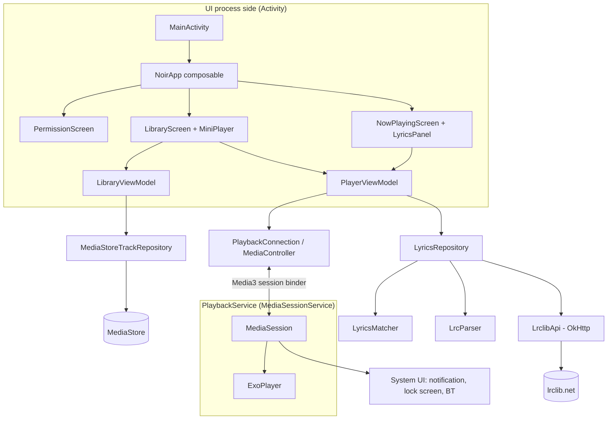
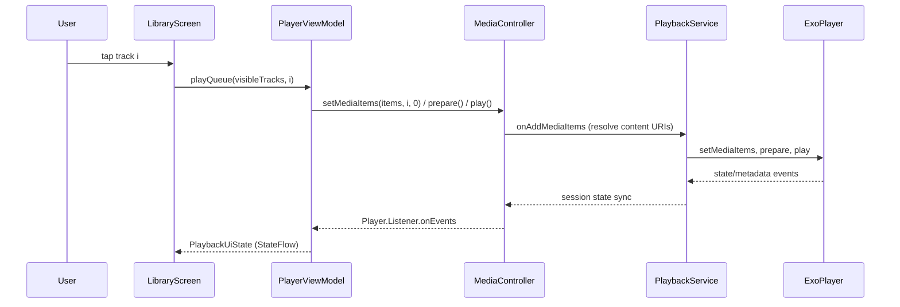
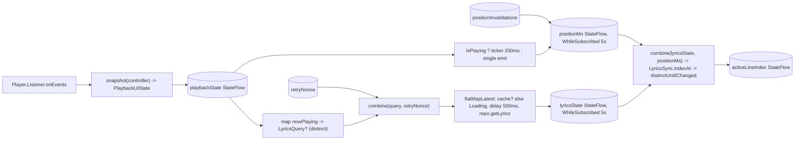
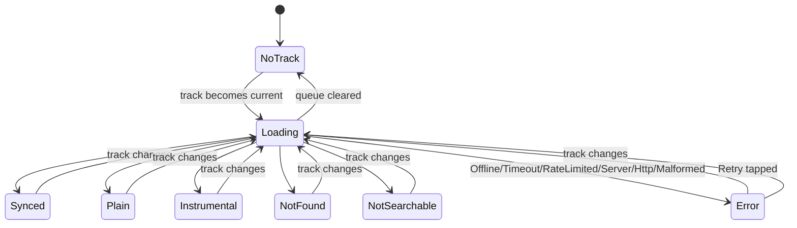
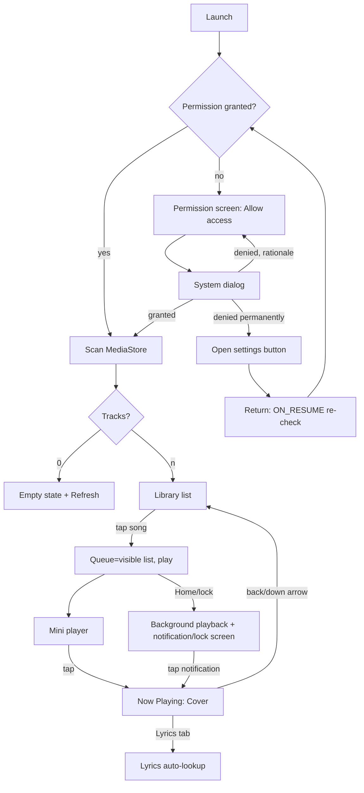

# Noir Music — Implementation Specification (MVP)

Status: design only, no app code written. Prepared 2026-10-23.
Facts were checked against: Google Maven / Maven Central `maven-metadata.xml`, AAR `aar-metadata.properties` (minCompileSdk / min AGP), the LRCLIB API docs (lrclib.net/docs), and the Android Media3 session docs. Where a fact could not be checked against a primary source, it is labelled **UNVERIFIED** and has a fallback rule.

---

## A. PRD

### A.1 Problem & goal
The owner wants a private, ad-free, account-free Android player for audio files stored on their phone. It should have a calm dark UI and show lyrics automatically, synced to playback when synced lyrics exist. It is distributed as a debug APK only.

### A.2 Users
One user (the owner) on a modern Android phone (Android 8.0+, mostly Android 13–17).

### A.3 In scope (MVP)
| # | Capability |
|---|---|
| F1 | Request the audio permission for the OS version. Scan MediaStore for music. Show loading / empty / error / permission states. |
| F2 | Song list: title, artist, duration. Case- and diacritic-insensitive search. Sort by Title, Artist, or Recently added. Fallbacks for missing metadata. |
| F3 | Now Playing: embedded artwork (or a placeholder), title, artist, seek slider, elapsed/total time, play/pause, previous/next, shuffle toggle, repeat cycle (off → all → one). |
| F4 | Queue = the song list as shown (filtered + sorted) when the user taps a song, starting at that song. |
| F5 | Background playback through a Media3 `MediaSessionService` that owns ExoPlayer and the `MediaSession`. Media notification, lock-screen and Bluetooth/headset controls, audio focus, and pause when headphones are unplugged. |
| F6 | Automatic lyrics lookup on LRCLIB (`/api/get`, then a validated `/api/search` fallback). Synced display with auto-scroll and tap-to-seek. Plain-lyrics fallback. Instrumental, not-found and error states. |
| F7 | Mini player on the library screen. Tapping the notification opens Now Playing. |
| F8 | Unit tests for the LRC parser, sync index, matcher, API client, repository state transitions, list logic, permission logic and play/pause logic. |

### A.4 Non-goals (explicitly out of scope)
Streaming or online catalogs, accounts, backend, analytics, crash reporting, ads, playlists, favourites, tag editing, an equalizer, gapless/crossfade settings, a sleep timer, widgets, Android Auto / Wear / Cast, playback resumption after reboot (no `MediaButtonReceiver`), folder browsing, album/artist screens, list artwork thumbnails, a queue editing UI, lyrics editing/submission to LRCLIB, persistent lyrics cache, light theme, dynamic color, localization beyond English strings, tablet/landscape layouts (they must not crash, but are not optimized), and Play Store release/signing.

### A.5 Product decisions (ambiguities resolved)
| Topic | Decision | Reason |
|---|---|---|
| When lyrics are fetched | Automatically when the Now Playing screen is visible and the current track changes (500 ms debounce). No prefetch, no background fetch. | Meets "automatic" while sending as few requests as possible. |
| Lyrics persistence | In-memory LRU (100 entries) for the process lifetime only. Nothing is written to disk. | Privacy; avoids repeat requests in a session. |
| `album_name` | Not sent to LRCLIB. Used only as a tie-breaker hint, not as a filter. | MediaStore album tags are often wrong ("Download", "Unknown"). They would cause false 404s. |
| Retrying after errors | No automatic retry. The user taps **Retry**. During a 429 cooldown, no requests are sent at all. | Considerate client; no polling. |
| Swiping the app from Recents | If paused, stopped or the queue is empty, stop the service. If playing, keep playing. | Standard music-app behavior. |
| Playback error | Show an inline error on Now Playing and the mini player. No auto-skip (avoids skip loops). Next/Prev/Play recover by calling `prepare()`. | Simple and predictable. |
| POST_NOTIFICATIONS | Not declared or requested. | Media-session notifications are exempt from the Android 13 notification permission (developer.android.com, "Notification runtime permission → Exemptions → Media sessions"). |
| Artwork source | Embedded artwork from `MediaMetadata.artworkData` only. Otherwise a placeholder. | No image library or MediaStore thumbnail logic is needed. Media3 notifications use the same data. |
| Icons | `material-icons-extended` (version managed by the BOM). | Reliable glyphs. Hand-written path data is error-prone. Larger debug APK is acceptable. |
| Navigation | No navigation library. Library is the root. Now Playing is a full-screen overlay controlled by a saveable boolean plus a `BackHandler`. | Two screens do not justify a navigation library. |

---

## B. Architecture

### B.1 Style
A single `:app` module with MVVM and repositories. Manual DI through an `AppContainer` owned by `NoirApplication`. Coroutines and `StateFlow` everywhere. Pure logic (parsing, matching, sorting, decisions) lives in Android-free Kotlin objects so it can be unit-tested on the JVM.



### B.2 Component responsibilities
| Component | Owns | Must not |
|---|---|---|
| `PlaybackService` | Creating and releasing ExoPlayer and the `MediaSession`. Audio attributes and focus, becoming-noisy handling, wake mode, session activity intent, `onAddMediaItems` URI resolution, `onTaskRemoved` policy. | Know about Compose, ViewModels or lyrics. |
| `PlaybackConnection` | Building a `MediaController` asynchronously for the service's `SessionToken`. Exposes `suspend fun await(): MediaController` and `release()`. | Hold an `Activity` context (uses the application context). |
| `PlayerViewModel` | The controller lifecycle (connect in `init`, release in `onCleared`), the `Player.Listener`, `PlaybackUiState`, the position ticker, the artwork decode, the lyrics pipeline, and user commands. | Create or own a player. Every command goes through `MediaController` on the main thread. |
| `LibraryViewModel` | Scanning, query/sort state, and `LibraryUiState`. | Touch playback. It hands the visible list to `PlayerViewModel.playQueue`. |
| `MediaStoreTrackRepository` | The MediaStore query on `Dispatchers.IO` and row → `Track` mapping. | Cache to disk. |
| `LrclibApi` | HTTP calls, URL building, headers, status → `ApiResult` mapping, JSON decoding. | Retry or sleep. |
| `LyricsRepository` | The lookup policy (get → search), the cooldown, in-flight de-duplication, the in-memory LRU, and record → `LyricsResult` conversion. | Do UI formatting. |
| `LyricsMatcher` / `TextNormalizer` / `LrcParser` / `LyricsSync` | Pure functions. | Do I/O or Android calls. |

### B.3 Service / controller boundary (invariants)
1. ExoPlayer is constructed only in `PlaybackService.onCreate()` and released only in `PlaybackService.onDestroy()`.
2. The UI never sees an `ExoPlayer`. It uses `MediaController` (a `Player`), connected through `SessionToken(context, ComponentName(context, PlaybackService::class.java))`.
3. `MediaController` is created and used on the main thread. `PlayerViewModel` calls it only from `viewModelScope` (Main.immediate) or listener callbacks.
4. The controller sends `MediaItem`s with `mediaId = track.id.toString()` and `MediaMetadata` (title, artist, albumTitle, durationMs). The service's `MediaSession.Callback.onAddMediaItems` rebuilds each item with `setUri(ContentUris.withAppendedId(audioCollectionUri, mediaId.toLong()))`, keeping the metadata. It returns `Futures.immediateFuture(list)`. Items whose `mediaId` is not a number are dropped. (Media3 does not reliably carry a `localConfiguration` URI from a controller to the session, so this resolution is mandatory.)
5. Starting playback through the controller promotes the service to foreground. Media3's `DefaultMediaNotificationProvider` posts the media notification. No custom notification code.



### B.4 Playback and lyrics state flow



A cache hit goes straight from the track change to the cached state without a Loading step or debounce.

### B.5 Threading
- MediaStore query: `Dispatchers.IO`. Sorting and filtering: `Dispatchers.Default`.
- HTTP: OkHttp `enqueue` wrapped in `suspendCancellableCoroutine`; coroutine cancellation cancels the `Call`. JSON decoding: `Dispatchers.Default`.
- Artwork decode: `Dispatchers.Default`, downsampled to at most 1024 px.
- Never call `runBlocking`. Never use `GlobalScope`. The only long-lived scope outside ViewModels is `AppContainer.appScope = CoroutineScope(SupervisorJob() + Dispatchers.IO)`. It is used only for shared in-flight lyrics requests.

---

## C. Dependencies, SDK, manifest

### C.1 Versions (checked 2026-10-23 against repository metadata)
| Item | Version | Reasoning / evidence |
|---|---|---|
| Android Gradle Plugin `com.android.application` | **9.4.1** | Latest stable on Google Maven. AGP 9 has built-in Kotlin, so do **not** apply `org.jetbrains.kotlin.android`. |
| Gradle wrapper | **9.6.0** | Minimum Gradle for AGP 9.4 per the AGP release notes (seen via search summary, **UNVERIFIED** against the primary page). Already in the owner's local Gradle cache. Fallback: if AGP reports a higher minimum, use that exact version. |
| Kotlin (KGP via `org.jetbrains.kotlin.plugin.compose` and `.serialization`) | **2.4.21** | Latest stable on Maven Central. Declaring these plugins with this version puts KGP 2.4.21 on the build classpath, and AGP's built-in Kotlin uses it. AGP 9.4.1 + KGP 2.4.21 compatibility is **UNVERIFIED**. Fallback: use the newest 2.3.x patch for all three Kotlin entries. |
| Compose BOM | **2026.09.00** | Latest stable. Maps ui/foundation 1.12.1 and material3 1.4.0. |
| `androidx.compose.material:material-icons-extended` | from BOM (1.7.8) | Media icons. |
| `androidx.activity:activity-compose` | **1.13.0** | Latest stable. minCompileSdk 36. |
| `androidx.lifecycle:lifecycle-viewmodel-compose`, `lifecycle-runtime-compose` | **2.11.0** | Latest stable. AAR metadata: minCompileSdk **37**, min AGP 9.1.0. |
| `androidx.core:core-ktx` | **1.19.1** | Latest stable. AAR metadata: minCompileSdk **37**, min AGP 9.1.0. |
| `androidx.media3:media3-exoplayer`, `media3-session` | **1.11.1** | Latest stable (1.12.0 is alpha). minCompileSdk 36, minSdk 23. Exposes Guava `ListenableFuture` transitively. |
| `org.jetbrains.kotlinx:kotlinx-coroutines-android` / `-test` | **1.11.0** | Latest stable. |
| `org.jetbrains.kotlinx:kotlinx-serialization-json` | **1.12.0** | Latest stable. JVM-testable, unlike `org.json` (stubbed in unit tests). |
| `com.squareup.okhttp3:okhttp` / `mockwebserver3` | **5.5.1** | Latest stable. Small, mature, and cancellable. MockWebServer is used for API tests. |
| `junit:junit` | **4.13.2** | Plain JVM unit tests. |

| SDK setting | Value | Reasoning |
|---|---|---|
| `compileSdk` | **37** | Required by core 1.19.1 and lifecycle 2.11.0 (minCompileSdk 37). Within AGP 9.4's supported range. The owner's machine currently has platforms 33–36 only. **Install "Android SDK Platform 37" first.** |
| `targetSdk` | **36** (Android 16) | Current, well-understood behavior. Satisfies the 2026 Play target requirement (not that it matters for a debug APK). Avoids unverified Android 17 behavior changes. Edge-to-edge is enforced, so insets must be handled. |
| `minSdk` | **26** (Android 8.0) | Covers practically all phones in use. Gives `java.time` and notification channels. Media3/Compose need 23. |
| JDK | 17+ (Android Studio's bundled JBR 21 recommended) | AGP 9 requires JDK 17+. Bytecode target 17. |
| Build tools | Default chosen by AGP (36.0.0 is already installed) | Do not pin `buildToolsVersion`. |

Fallback rule for the coding model: change only the specific version that fails resolution or compatibility. Use the nearest **stable** release from Google Maven / Maven Central and record the change in the output. Never use alpha/beta/rc. Never invent a version.

### C.2 `gradle/libs.versions.toml` (normative content)
```toml
[versions]
agp = "9.4.1"
kotlin = "2.4.21"
composeBom = "2026.09.00"
activityCompose = "1.13.0"
lifecycle = "2.11.0"
coreKtx = "1.19.1"
media3 = "1.11.1"
coroutines = "1.11.0"
serialization = "1.12.0"
okhttp = "5.5.1"
junit = "4.13.2"

[libraries]
androidx-core-ktx = { module = "androidx.core:core-ktx", version.ref = "coreKtx" }
androidx-activity-compose = { module = "androidx.activity:activity-compose", version.ref = "activityCompose" }
androidx-lifecycle-viewmodel-compose = { module = "androidx.lifecycle:lifecycle-viewmodel-compose", version.ref = "lifecycle" }
androidx-lifecycle-runtime-compose = { module = "androidx.lifecycle:lifecycle-runtime-compose", version.ref = "lifecycle" }
compose-bom = { module = "androidx.compose:compose-bom", version.ref = "composeBom" }
compose-ui = { module = "androidx.compose.ui:ui" }
compose-ui-graphics = { module = "androidx.compose.ui:ui-graphics" }
compose-ui-tooling-preview = { module = "androidx.compose.ui:ui-tooling-preview" }
compose-ui-tooling = { module = "androidx.compose.ui:ui-tooling" }
compose-foundation = { module = "androidx.compose.foundation:foundation" }
compose-material3 = { module = "androidx.compose.material3:material3" }
compose-material-icons-extended = { module = "androidx.compose.material:material-icons-extended" }
media3-exoplayer = { module = "androidx.media3:media3-exoplayer", version.ref = "media3" }
media3-session = { module = "androidx.media3:media3-session", version.ref = "media3" }
kotlinx-coroutines-android = { module = "org.jetbrains.kotlinx:kotlinx-coroutines-android", version.ref = "coroutines" }
kotlinx-coroutines-test = { module = "org.jetbrains.kotlinx:kotlinx-coroutines-test", version.ref = "coroutines" }
kotlinx-serialization-json = { module = "org.jetbrains.kotlinx:kotlinx-serialization-json", version.ref = "serialization" }
okhttp = { module = "com.squareup.okhttp3:okhttp", version.ref = "okhttp" }
okhttp-mockwebserver3 = { module = "com.squareup.okhttp3:mockwebserver3", version.ref = "okhttp" }
junit = { module = "junit:junit", version.ref = "junit" }

[plugins]
android-application = { id = "com.android.application", version.ref = "agp" }
kotlin-compose = { id = "org.jetbrains.kotlin.plugin.compose", version.ref = "kotlin" }
kotlin-serialization = { id = "org.jetbrains.kotlin.plugin.serialization", version.ref = "kotlin" }
```

### C.3 Build configuration rules
- Root `build.gradle.kts`: `plugins { alias(libs.plugins.android.application) apply false; alias(libs.plugins.kotlin.compose) apply false; alias(libs.plugins.kotlin.serialization) apply false }`.
- `settings.gradle.kts`: `pluginManagement` repos `google()`, `mavenCentral()`, `gradlePluginPortal()`. `dependencyResolutionManagement` uses `RepositoriesMode.FAIL_ON_PROJECT_REPOS` with `google()`, `mavenCentral()`. `rootProject.name = "NoirMusic"`, `include(":app")`.
- `app/build.gradle.kts`: plugins `android.application`, `kotlin.compose`, `kotlin.serialization`. `namespace = applicationId = "com.noirmusic"`, `versionCode = 1`, `versionName = "1.0.0"`. `buildFeatures { compose = true; buildConfig = true }`. Java 17 `compileOptions`. `testOptions.unitTests.isReturnDefaultValues = true`. `buildConfigField("String", "LRCLIB_CLIENT_CONTACT", "\"${providers.gradleProperty("noirMusic.clientContact").getOrElse("")}\"")`. Debug only; leave the release type default with `isMinifyEnabled = false`.
- `gradle.properties`: `org.gradle.jvmargs=-Xmx4g -Dfile.encoding=UTF-8`, `android.useAndroidX=true`, `kotlin.code.style=official`, `noirMusic.clientContact=` (empty by default; the owner may set a URL or email).
- Gradle wrapper: generate it with a real Gradle 9.6.0 binary (Section G.3). Never hand-write `gradle-wrapper.jar`.

### C.4 Permissions & manifest (normative)
```xml
<manifest xmlns:android="http://schemas.android.com/apk/res/android">
    <uses-permission android:name="android.permission.READ_MEDIA_AUDIO" />                      <!-- API 33+ -->
    <uses-permission android:name="android.permission.READ_EXTERNAL_STORAGE"
                     android:maxSdkVersion="32" />                                                <!-- API 26–32 -->
    <uses-permission android:name="android.permission.INTERNET" />
    <uses-permission android:name="android.permission.FOREGROUND_SERVICE" />
    <uses-permission android:name="android.permission.FOREGROUND_SERVICE_MEDIA_PLAYBACK" />       <!-- API 34+ -->
    <uses-permission android:name="android.permission.WAKE_LOCK" />                              <!-- ExoPlayer WAKE_MODE_LOCAL -->

    <application
        android:name=".NoirApplication"
        android:label="@string/app_name"
        android:icon="@mipmap/ic_launcher"
        android:roundIcon="@mipmap/ic_launcher_round"
        android:theme="@style/Theme.NoirMusic"
        android:allowBackup="false"
        android:supportsRtl="true"
        android:enableOnBackInvokedCallback="true">
        <activity
            android:name=".MainActivity"
            android:exported="true"
            android:launchMode="singleTop"
            android:windowSoftInputMode="adjustResize">
            <intent-filter>
                <action android:name="android.intent.action.MAIN" />
                <category android:name="android.intent.category.LAUNCHER" />
            </intent-filter>
        </activity>
        <service
            android:name=".playback.PlaybackService"
            android:exported="true"
            android:foregroundServiceType="mediaPlayback">
            <intent-filter>
                <action android:name="androidx.media3.session.MediaSessionService" />
            </intent-filter>
        </service>
    </application>
</manifest>
```
Not declared: `MANAGE_EXTERNAL_STORAGE`, `POST_NOTIFICATIONS`, `ACCESS_NETWORK_STATE`, `READ_MEDIA_VISUAL_USER_SELECTED` (partial access applies only to photos/videos, not audio).

---

## D. Project tree & file-by-file plan

```
NoirMusic/
├── settings.gradle.kts
├── build.gradle.kts
├── gradle.properties
├── gradle/libs.versions.toml
├── gradle/wrapper/gradle-wrapper.jar           (generated)
├── gradle/wrapper/gradle-wrapper.properties    (generated, 9.6.0-bin)
├── gradlew, gradlew.bat                        (generated)
├── .gitignore                                  (build/, .gradle/, local.properties, .idea/, *.iml)
├── README.md                                   (build/install/verify steps from Section G)
└── app/
    ├── build.gradle.kts
    └── src/
        ├── main/
        │   ├── AndroidManifest.xml
        │   ├── res/values/strings.xml
        │   ├── res/values/colors.xml
        │   ├── res/values/themes.xml
        │   ├── res/drawable/ic_launcher_foreground.xml
        │   ├── res/drawable/ic_launcher_monochrome.xml
        │   ├── res/drawable/media3_notification_small_icon.xml
        │   ├── res/mipmap-anydpi-v26/ic_launcher.xml
        │   ├── res/mipmap-anydpi-v26/ic_launcher_round.xml
        │   └── java/com/noirmusic/
        │       ├── NoirApplication.kt
        │       ├── AppContainer.kt
        │       ├── MainActivity.kt
        │       ├── data/model/Track.kt
        │       ├── data/media/TrackRepository.kt
        │       ├── data/media/TrackMapper.kt
        │       ├── data/media/TrackListLogic.kt
        │       ├── data/lyrics/LyricsModels.kt
        │       ├── data/lyrics/LrclibDto.kt
        │       ├── data/lyrics/LrclibApi.kt
        │       ├── data/lyrics/HttpErrorMapping.kt
        │       ├── data/lyrics/LrcParser.kt
        │       ├── data/lyrics/LyricsSync.kt
        │       ├── data/lyrics/TextNormalizer.kt
        │       ├── data/lyrics/LyricsMatcher.kt
        │       ├── data/lyrics/LyricsRepository.kt
        │       ├── playback/PlaybackService.kt
        │       ├── playback/PlaybackConnection.kt
        │       ├── playback/MediaItemMapper.kt
        │       ├── playback/PlayerLogic.kt
        │       ├── ui/NoirApp.kt
        │       ├── ui/theme/Color.kt
        │       ├── ui/theme/Type.kt
        │       ├── ui/theme/Theme.kt
        │       ├── ui/common/StateViews.kt
        │       ├── ui/common/TimeFormat.kt
        │       ├── ui/permission/AudioPermission.kt
        │       ├── ui/permission/PermissionScreen.kt
        │       ├── ui/library/LibraryViewModel.kt
        │       ├── ui/library/LibraryScreen.kt
        │       ├── ui/library/TrackRow.kt
        │       ├── ui/player/PlayerViewModel.kt
        │       ├── ui/player/PlaybackUiState.kt
        │       ├── ui/player/MiniPlayer.kt
        │       ├── ui/player/NowPlayingScreen.kt
        │       ├── ui/player/Artwork.kt
        │       └── ui/player/LyricsPanel.kt
        └── test/java/com/noirmusic/
            ├── data/lyrics/LrcParserTest.kt
            ├── data/lyrics/LyricsSyncTest.kt
            ├── data/lyrics/TextNormalizerTest.kt
            ├── data/lyrics/LyricsMatcherTest.kt
            ├── data/lyrics/LrclibApiTest.kt
            ├── data/lyrics/HttpErrorMappingTest.kt
            ├── data/lyrics/LyricsRepositoryTest.kt
            ├── data/media/TrackListLogicTest.kt
            ├── data/media/TrackMapperTest.kt
            ├── playback/PlayerLogicTest.kt
            ├── ui/common/TimeFormatTest.kt
            └── ui/permission/AudioPermissionTest.kt
```

### D.1 File responsibilities
| File | Contents |
|---|---|
| `NoirApplication.kt` | `class NoirApplication : Application()` with `lateinit var container: AppContainer`, created in `onCreate`. |
| `AppContainer.kt` | Builds `appScope`, `Json`, `OkHttpClient` (timeouts: connect 10 s, read 15 s, call 20 s; interceptor adds `User-Agent` and `Accept: application/json`), `LrclibApi(baseUrl = "https://lrclib.net/".toHttpUrl())`, `LyricsRepository(api, appScope, clock = SystemClock::elapsedRealtime)`, and `MediaStoreTrackRepository(contentResolver)`. Exposes `userAgent` built by `buildUserAgent(versionName, contact)` (pure; see E.6). Exposes `ViewModelProvider.Factory` builders using `viewModelFactory { initializer { … } }`. |
| `MainActivity.kt` | `ComponentActivity`. Calls `enableEdgeToEdge(SystemBarStyle.dark(Color.TRANSPARENT), SystemBarStyle.dark(Color.TRANSPARENT))`. Obtains both ViewModels by `viewModels { factory }`. `setContent { NoirTheme { NoirApp(...) } }`. Handles `EXTRA_OPEN_PLAYER` in `onCreate` and `onNewIntent` by setting a `MutableStateFlow<Boolean>` "openPlayerRequest" consumed by `NoirApp`. |
| `data/model/Track.kt` | `data class Track(id: Long, title: String, artist: String?, album: String?, durationMs: Long, dateAddedSec: Long, titleFromFileName: Boolean)` plus `val displayArtist get() = artist ?: "Unknown artist"`. |
| `data/media/TrackRepository.kt` | `interface TrackRepository { suspend fun loadTracks(): List<Track> }`. `MediaStoreTrackRepository` queries the collection (`MediaStore.Audio.Media.getContentUri(MediaStore.VOLUME_EXTERNAL)` on API 29+, else `EXTERNAL_CONTENT_URI`). Projection: `_ID, TITLE, ARTIST, ALBUM, DURATION, DATE_ADDED, DISPLAY_NAME`. Selection: `IS_MUSIC != 0`. Runs `withContext(Dispatchers.IO)`, maps through `TrackMapper`, and closes the cursor with `use`. Also exposes `fun audioCollectionUri(): Uri` for reuse by the service. |
| `data/media/TrackMapper.kt` | Pure `fun fromRow(id, title?, artist?, album?, durationMs?, dateAdded?, displayName?): Track`. See the metadata rules in E.1. |
| `data/media/TrackListLogic.kt` | `enum class SortOrder { TITLE, ARTIST, RECENTLY_ADDED }` and pure `fun apply(tracks, query, sort, collator): List<Track>`. |
| `data/lyrics/LyricsModels.kt` | `LyricLine`, `LyricsQuery`, `LyricsResult`, `LyricsError`, `ApiResult` (E.2). |
| `data/lyrics/LrclibDto.kt` | `@Serializable data class LrclibRecordDto` (E.2). |
| `data/lyrics/LrclibApi.kt` | `interface LrclibDataSource { suspend fun get(...); suspend fun search(...) }` and `class LrclibApi(client, json, baseUrl: HttpUrl, clock: () -> Long = System::currentTimeMillis) : LrclibDataSource`. `clock` is wall-clock and is used only for HTTP-date Retry-After. |
| `data/lyrics/HttpErrorMapping.kt` | Pure `fun mapIoException(e: IOException): LyricsError` and `fun parseRetryAfterSeconds(header: String?, nowEpochMs: Long): Long`. |
| `data/lyrics/LrcParser.kt` | `object LrcParser { fun parse(lrc: String): List<LyricLine>; fun plainLines(text: String): List<String> }`. |
| `data/lyrics/LyricsSync.kt` | `object LyricsSync { fun indexAt(lines: List<LyricLine>, positionMs: Long): Int }` (binary search). |
| `data/lyrics/TextNormalizer.kt` | `object TextNormalizer { fun normalize(s): String; fun cleanTitle(s): String; fun splitArtists(s): List<String>; fun isUnknownArtist(s?): Boolean }`. |
| `data/lyrics/LyricsMatcher.kt` | `object LyricsMatcher { fun isAcceptable(query, dto): Boolean; fun selectBest(query, dtos): LrclibRecordDto? }`. |
| `data/lyrics/LyricsRepository.kt` | `class LyricsRepository(api: LrclibDataSource, scope: CoroutineScope, clock: () -> Long)` with `suspend fun getLyrics(query): LyricsResult` and `fun cached(query): LyricsResult?`. |
| `playback/PlaybackService.kt` | Section E.7. |
| `playback/PlaybackConnection.kt` | `class PlaybackConnection(appContext)`. `suspend fun await(): MediaController`, built once with `MediaController.Builder(ctx, token).buildAsync()` and awaited with `suspendCancellableCoroutine` + `future.addListener(…, ContextCompat.getMainExecutor(ctx))`. `fun release()` calls `MediaController.releaseFuture(future)`. |
| `playback/MediaItemMapper.kt` | `fun Track.toMediaItem(): MediaItem` (mediaId, MediaMetadata title/artist/albumTitle/durationMs, `setIsPlayable(true)`, `setIsBrowsable(false)`). `fun resolveForPlayback(item, collectionUri): MediaItem?` used by the service. |
| `playback/PlayerLogic.kt` | Pure: `enum PlayPauseAction { PAUSE, PLAY, PREPARE_AND_PLAY, RESTART_AND_PLAY, NONE }`; `fun resolvePlayPause(playbackState: Int, playWhenReady: Boolean, itemCount: Int): PlayPauseAction`; `fun nextRepeatMode(mode: Int): Int` (OFF→ALL→ONE→OFF); `fun needsPrepare(playbackState: Int): Boolean`. Uses `Player.STATE_*` / `Player.REPEAT_MODE_*` int constants (plain constants, usable on the JVM). |
| `ui/NoirApp.kt` | Root composable: permission gate → Library, with the Now Playing overlay (`AnimatedVisibility` slide up/down), `BackHandler`, and the open-player request. |
| `ui/theme/*` | Section F.1. |
| `ui/common/StateViews.kt` | `CenteredMessage(icon, title, body, actionLabel?, onAction?)` and `LoadingView(text)`. |
| `ui/common/TimeFormat.kt` | Pure `fun formatDuration(ms: Long): String` → `m:ss`, or `h:mm:ss` if ≥ 1 h. Any `ms < 0` (including `C.TIME_UNSET`) gives `--:--`. |
| `ui/permission/AudioPermission.kt` | Pure: `fun audioPermissionFor(sdkInt: Int): String`; `enum PermissionStatus { GRANTED, CAN_REQUEST, PERMANENTLY_DENIED }`; `fun resolveAfterResult(granted: Boolean, shouldShowRationale: Boolean): PermissionStatus`; `fun resolveInitial(granted: Boolean): PermissionStatus`. |
| `ui/permission/PermissionScreen.kt` | Gate UI, `rememberLauncherForActivityResult(RequestPermission())`, an Open Settings intent (`ACTION_APPLICATION_DETAILS_SETTINGS`, `package:` URI), and a re-check on `Lifecycle.Event.ON_RESUME` via `LifecycleEventEffect`. |
| `ui/library/*` | Section F.2. |
| `ui/player/*` | Section F.3 and the PlayerViewModel spec in E.8. |

---

## E. Data, state, errors, parsing, LRCLIB policy

### E.1 Track metadata rules (`TrackMapper`)
- `title`: trimmed `TITLE`. If null or blank, use `DISPLAY_NAME` without its last extension and set `titleFromFileName = true`. If that is also blank, use `"Unknown title"` and set `titleFromFileName = true`.
- `artist`: trimmed. `null` if blank or if `TextNormalizer.isUnknownArtist` matches (case-insensitive `<unknown>`, `unknown`, `unknown artist`).
- `album`: trimmed. `null` if blank or `<unknown>`.
- `durationMs`: `max(0, DURATION ?: 0)`. A value of 0 means unknown.
- `dateAddedSec`: `DATE_ADDED ?: 0`.

### E.2 Models
```kotlin
data class LyricLine(val timeMs: Long, val text: String)          // text may be "" (instrumental gap)

data class LyricsQuery(
    val mediaId: String,
    val title: String,
    val artist: String?,          // null = unknown
    val album: String?,
    val durationSec: Int?,        // round(durationMs/1000.0); null if result !in 1..3600
    val titleFromFileName: Boolean,
) { val cacheKey: String get() = listOf(mediaId, TextNormalizer.normalize(title),
        artist?.let(TextNormalizer::normalize).orEmpty(), durationSec?.toString().orEmpty()).joinToString("|") }

sealed interface LyricsError {
    data object Offline : LyricsError
    data object Timeout : LyricsError
    data class RateLimited(val retryAfterSec: Long) : LyricsError
    data class Server(val code: Int) : LyricsError        // 5xx
    data class Http(val code: Int) : LyricsError          // other unexpected non-2xx (e.g. 400)
    data object Malformed : LyricsError
    data object Network : LyricsError                     // other IOException
}

sealed interface LyricsResult {
    data class Synced(val lines: List<LyricLine>, val plainText: String?) : LyricsResult
    data class Plain(val lines: List<String>) : LyricsResult
    data object Instrumental : LyricsResult
    data object NotFound : LyricsResult
    data object NotSearchable : LyricsResult
    data class Failed(val error: LyricsError) : LyricsResult
}

sealed interface ApiResult<out T> {
    data class Success<T>(val value: T) : ApiResult<T>
    data class Failure(val error: LyricsError) : ApiResult<Nothing>
}

@Serializable
data class LrclibRecordDto(
    val id: Long? = null,
    val trackName: String? = null,
    val artistName: String? = null,
    val albumName: String? = null,
    val duration: Double? = null,
    val instrumental: Boolean = false,
    val plainLyrics: String? = null,
    val syncedLyrics: String? = null,
)
// Json { ignoreUnknownKeys = true; explicitNulls = false; coerceInputValues = true }
```

UI state models (`ui/player/PlaybackUiState.kt`, `ui/library/LibraryViewModel.kt`):
```kotlin
data class NowPlaying(val mediaId: String, val title: String, val artist: String?, val album: String?,
                      val durationMs: Long, val titleFromFileName: Boolean)

data class PlaybackUiState(
    val isConnected: Boolean = false,
    val nowPlaying: NowPlaying? = null,
    val isPlaying: Boolean = false,        // controller.isPlaying
    val isBuffering: Boolean = false,      // playbackState == STATE_BUFFERING
    val playbackState: Int = Player.STATE_IDLE,
    val playWhenReady: Boolean = false,
    val durationMs: Long = 0,              // controller.duration if >0 else nowPlaying.durationMs
    val hasPrevious: Boolean = false,      // itemCount > 0 (seekToPrevious restarts current track)
    val hasNext: Boolean = false,          // controller.hasNextMediaItem()
    val shuffleEnabled: Boolean = false,
    val repeatMode: Int = Player.REPEAT_MODE_OFF,
    val queueIndex: Int = -1,
    val queueSize: Int = 0,
    val errorMessage: String? = null,      // from controller.playerError, cleared on next successful state
)

sealed interface LyricsUiState {
    data object NoTrack : LyricsUiState
    data object Loading : LyricsUiState
    data class Synced(val lines: List<LyricLine>) : LyricsUiState
    data class Plain(val lines: List<String>) : LyricsUiState
    data object Instrumental : LyricsUiState
    data object NotFound : LyricsUiState
    data object NotSearchable : LyricsUiState
    data class Error(val error: LyricsError) : LyricsUiState
}

sealed interface LibraryUiState {
    data object Loading : LibraryUiState
    data object Empty : LibraryUiState                                 // scan OK, 0 tracks
    data class Error(val message: String) : LibraryUiState
    data class Content(val all: List<Track>, val visible: List<Track>,
                       val query: String, val sort: SortOrder) : LibraryUiState
}
```
`nowPlaying` comes from `controller.currentMediaItem` (mediaId + its `mediaMetadata`, i.e. MediaStore-derived values). It deliberately does not use embedded tags, so the lyrics query key is stable from the first event. `titleFromFileName` is carried in `MediaMetadata.extras` (`Bundle`, key `"noir.titleFromFileName"`).

### E.3 LRC parsing rules (`LrcParser.parse`)
1. Strip a leading BOM `\uFEFF`. Split on `\r\n|\n|\r`.
2. For each line, repeatedly consume leading bracket tags `[...]` (whitespace between tags is allowed):
   - Time tag regex: `^\[(\d{1,3}):(\d{1,2})(?:[.:](\d{1,3}))?\]`. Minutes may be any 1–3 digits. Seconds must be `0..59`, otherwise the tag is invalid and the line is ignored. Fraction: 1 digit = ×100 ms, 2 digits = ×10 ms, 3 digits = ms.
   - Metadata tag regex: `^\[([a-zA-Z]+):(.*)\]$` on a line with no time tag. `offset` (case-insensitive) is parsed as a signed integer in ms. All other metadata (`ar, ti, al, by, length, re, ve, au, #`) is ignored.
   - Any other bracket content (e.g. `[chorus]`) on a line without a valid time tag means the line is ignored.
3. Text = the remainder after the time tags. Remove inline word timestamps matching `<\d{1,3}:\d{1,2}(?:[.:]\d{1,3})?>`, then trim. Empty text is kept as `""`.
4. Each time tag on a line produces one `LyricLine(t, text)`.
5. Apply the offset: `effective = max(0, t - offset)`. A positive offset makes lyrics appear earlier. The offset applies to the whole file, wherever the tag appears.
6. Stable sort by `timeMs`. Never throw: malformed input yields fewer or zero lines.
7. If the result contains no non-empty text, treat synced lyrics as absent.

`plainLines(text)`: BOM strip, split as above, `trimEnd()` each line, keep blank lines (rendered as spacing), drop leading and trailing blank lines. An empty result means absent.

`LyricsSync.indexAt(lines, pos)`: the index of the last line with `timeMs <= pos`, or `-1` if `pos < lines[0].timeMs` or the list is empty. Binary search, O(log n). Among equal timestamps, return the last one.

### E.4 Normalization & matching (`TextNormalizer`, `LyricsMatcher`)
`normalize(s)`:
1. NFKD, then remove `\p{M}`, then `lowercase(Locale.ROOT)`.
2. Replace `&` with ` and `.
3. Remove a featuring tail matching `(?i)[\s(\[]+(feat\.?|ft\.?|featuring)\s.*$`.
4. Replace `[^\p{L}\p{N}]+` with a space, collapse whitespace, and trim.
5. Remove a leading `the `.

`cleanTitle(s)` is used for search queries and title comparison:
- Remove bracket groups `(...)` or `[...]` whose content matches `(?i)\b(feat\.?|ft\.?|featuring|remaster(ed)?|\d{4} remaster(ed)?|radio edit|single version|album version|explicit|clean|mono|stereo|bonus track)\b`.
- Remove a dash suffix matching `(?i)\s+-\s+(\d{4}\s+)?(remaster(ed)?|radio edit|single version|mono|stereo)(\s+\d{4})?(\s+version)?\s*$`.
- Trim. If the result is blank, return the original trimmed string.
- Keep other parentheticals such as `(Live)` and `(Acoustic)`; the duration check handles version differences.

`splitArtists(s)`: split the raw string on `(?i)\s*(,|;|/|&|\+|\sx\s|\sfeat\.?\s|\sft\.?\s|\sfeaturing\s|\sand\s|\swith\s)\s*`, normalize each part, drop blanks, and dedupe.

Matching predicates (strings are compared after `normalize(cleanTitle(·))` for titles and `normalize` for artists):
- `titleMatches(a, b)`: `a == b`; or token Jaccard ≥ 0.75; or one `startsWith` the other with the shorter at least 4 characters. False if either is blank.
- `artistMatches(local, remote)`: full normalized strings are equal; or the split sets intersect; or one full string contains the other with the shorter at least 3 characters.
- `durationDiff = |query.durationSec − dto.duration|`, or `null` if either is unknown.

`isAcceptable(query, dto)`, all of which must hold:
1. `dto.instrumental` is true, or one of `syncedLyrics` / `plainLyrics` is non-blank.
2. `titleMatches(query.title, dto.trackName)`.
3. If `query.artist != null`: `artistMatches` holds, and `durationDiff == null || durationDiff <= 3.0`.
4. If `query.artist == null`: `durationDiff != null && durationDiff <= 2.0` (strict), and the normalized cleaned titles are exactly equal.

`selectBest(query, dtos)`: keep only acceptable candidates. Prefer non-instrumental candidates with lyrics. Sort by:
1. Has a parseable synced result (`LrcParser.parse(synced)` has non-empty text) — desc.
2. `durationDiff` ascending (null last).
3. Exact cleaned-title equality — desc.
4. Album normalized equality with `query.album` — desc.
5. `id` ascending, for determinism.

If no non-instrumental candidate is acceptable but an acceptable instrumental one exists, return the best instrumental. Otherwise return `null`. Never pick a candidate just because it came first.

Record → result (`toResult(dto)`): `instrumental` → `Instrumental`. Else, if parsed synced lines are non-empty → `Synced(lines, plainLyrics)`. Else, if `plainLines(plainLyrics)` is non-empty → `Plain`. Else → `NotFound`.

### E.5 LRCLIB endpoint, query and fallback policy (`LyricsRepository.getLyrics`)
Base: `https://lrclib.net`. Build every URL with OkHttp `HttpUrl.Builder.addQueryParameter`, which percent-encodes values (spaces become `%20`; `&`, `/` and non-ASCII are encoded). Never concatenate raw strings.

```
getLyrics(q):
  1. cache[q.cacheKey]?        -> return it                (LRU, 100 entries, definitive results only)
  2. inFlight[q.cacheKey]?     -> await the same Deferred   (Mutex-guarded map; Deferred launched in appScope)
  3. clock() < cooldownUntil   -> return Failed(RateLimited(ceil((cooldownUntil-clock())/1000)))  (no network)
  4. q.artist == null && q.titleFromFileName -> NotSearchable (cache it; no network)
  5. if q.artist != null:
        GET /api/get?track_name=<q.title>&artist_name=<q.artist>[&duration=<q.durationSec>]
        Failure(e)                     -> if e is RateLimited set cooldown; return Failed(e)   (do NOT continue to search)
        Success(dto) && isAcceptable   -> return toResult(dto) unless it is NotFound (then continue)
        Success(null /*404*/) or unacceptable -> continue
  6. GET /api/search?track_name=<cleanTitle(q.title)>[&artist_name=<q.artist>]
        Failure(e)                     -> same handling as above
        Success(list)                  -> selectBest(q, list)?.let(::toResult) ?: NotFound
  7. Cache Synced/Plain/Instrumental/NotFound/NotSearchable. Never cache Failed.
```
- At most **2 HTTP requests per track lookup**. No `q=` free-text search. No `album_name`.
- `duration` is sent only if it is in `1..3600` (LRCLIB's accepted range; `/api/get` matches within about ±2 s).
- The 500 ms debounce and request de-duplication across track changes live in `PlayerViewModel` (E.8). Repeated calls for the same key share the cache and in-flight request.

Status / exception mapping (`LrclibApi`):
| Condition | Mapping |
|---|---|
| 200 + valid JSON | `Success(dto)` / `Success(list)` |
| 200 + invalid JSON / wrong shape (`SerializationException`, `IllegalArgumentException`) | `Failure(Malformed)` |
| 404 on `/api/get` | `Success(null)` |
| 404 on `/api/search` | `Success(emptyList())` |
| 429 | `Failure(RateLimited(parseRetryAfterSeconds(header, clock())))`; the repository sets `cooldownUntil = repoClock() + sec*1000` |
| 500–599 | `Failure(Server(code))` |
| Other non-2xx | `Failure(Http(code))` |
| `UnknownHostException`, `ConnectException`, `NoRouteToHostException` | `Offline` |
| `SocketTimeoutException`, `InterruptedIOException` (call timeout) | `Timeout` |
| Other `IOException` | `Network` |
| `CancellationException` | rethrown, never mapped |

`parseRetryAfterSeconds(header, nowEpochMs)`: trim; if it is a non-negative integer, use it; else parse as RFC 1123 (`DateTimeFormatter.RFC_1123_DATE_TIME`) and use `ceil((date − now)/1000)`; else 60. Clamp to `[1, 3600]`.

### E.6 Client identification (LRCLIB docs)
LRCLIB asks clients to send a `User-Agent` with the app name, version and, if available, a homepage link. No API key is used or stored.
- `buildUserAgent(versionName, contact)`: `"Noir Music v$versionName (" + (contact.ifBlank { "personal non-commercial Android player" }) + ")"`, e.g. `Noir Music v1.0.0 (personal non-commercial Android player)`.
- `contact` comes from `BuildConfig.LRCLIB_CLIENT_CONTACT` (gradle property `noirMusic.clientContact`, empty by default; the owner may set a GitHub URL or email). Never invent a URL.
- Headers on every request: `User-Agent`, `Accept: application/json`. OkHttp handles gzip transparently.
- Considerate use: requests only on the visible Now Playing screen, debounced, de-duplicated, cached for the session, at most 2 per track, no polling, no automatic retry, and the 429 cooldown is honored globally. Data sent: title, artist, duration only.

### E.7 PlaybackService (normative behavior)
```kotlin
class PlaybackService : MediaSessionService() {
    private var mediaSession: MediaSession? = null
    override fun onCreate() {
        super.onCreate()
        val player = ExoPlayer.Builder(this)
            .setAudioAttributes(AudioAttributes.Builder()
                .setUsage(C.USAGE_MEDIA).setContentType(C.AUDIO_CONTENT_TYPE_MUSIC).build(),
                /* handleAudioFocus = */ true)
            .setHandleAudioBecomingNoisy(true)
            .setWakeMode(C.WAKE_MODE_LOCAL)
            .build()
        mediaSession = MediaSession.Builder(this, player)
            .setSessionActivity(PendingIntent.getActivity(this, 0,
                Intent(this, MainActivity::class.java)
                    .addFlags(Intent.FLAG_ACTIVITY_SINGLE_TOP)
                    .putExtra(MainActivity.EXTRA_OPEN_PLAYER, true),
                PendingIntent.FLAG_IMMUTABLE or PendingIntent.FLAG_UPDATE_CURRENT))
            .setCallback(SessionCallback(collectionUri))   // onAddMediaItems -> resolveForPlayback
            .build()
    }
    override fun onGetSession(controllerInfo: MediaSession.ControllerInfo) = mediaSession
    override fun onTaskRemoved(rootIntent: Intent?) {
        val p = mediaSession?.player
        if (p == null || !p.playWhenReady || p.mediaItemCount == 0 || p.playbackState == Player.STATE_ENDED) stopSelf()
    }
    override fun onDestroy() {
        mediaSession?.run { player.release(); release() }
        mediaSession = null
        super.onDestroy()
    }
}
```
- `SessionCallback.onAddMediaItems(session, controller, items)` returns `Futures.immediateFuture(items.mapNotNull { resolveForPlayback(it, collectionUri) })`. `onSetMediaItems` is left at its default, which delegates to `onAddMediaItems`.
- Small notification icon: provide `res/drawable/media3_notification_small_icon.xml` (a white music-note vector). This overrides Media3's default resource name.
- Do not override notification layout or add custom commands.
- Add `@OptIn(UnstableApi::class)` only where the compiler requires it.

### E.8 PlayerViewModel (normative behavior)
- Constructor: `(connection: PlaybackConnection, lyricsRepository: LyricsRepository)`.
- `init`: `viewModelScope.launch { val c = connection.await(); controller = c; c.addListener(listener); publish(c); controllerReady.complete(c) }`. Catch connection failure: set `errorMessage = "Couldn't connect to the player"` and keep `isConnected = false`.
- `onCleared()`: remove the listener, then call `connection.release()`.
- Listener `onEvents(player, events)`: `publish(player)`. Emit `positionInvalidations` on `EVENT_POSITION_DISCONTINUITY`, `EVENT_MEDIA_ITEM_TRANSITION`, `EVENT_PLAYBACK_STATE_CHANGED`, and `EVENT_IS_PLAYING_CHANGED`. Update `artworkSource` on `EVENT_MEDIA_METADATA_CHANGED` or `EVENT_MEDIA_ITEM_TRANSITION` with `ArtworkKey(mediaId, player.mediaMetadata.artworkData)`. Its `equals` compares mediaId plus `contentEquals` on the bytes.
- Commands (all `suspend`-safe; each awaits `controllerReady` before acting):
  - `playQueue(tracks: List<Track>, startIndex: Int)`: `setMediaItems(tracks.map { it.toMediaItem() }, startIndex, 0L)`, `prepare()`, `play()`.
  - `togglePlayPause()`: `resolvePlayPause(...)`. `PAUSE` → `pause()`. `PLAY` → `play()`. `PREPARE_AND_PLAY` → `prepare(); play()`. `RESTART_AND_PLAY` (ENDED) → `seekToDefaultPosition(0); play()`. `NONE` → nothing.
  - `next()` / `previous()`: if `needsPrepare(state)`, call `prepare()`. Then `seekToNext()` / `seekToPrevious()` (Media3's default restarts the track if the position is more than 3 s).
  - `seekTo(ms)`, `toggleShuffle()`, `cycleRepeat()` → `repeatMode = nextRepeatMode(repeatMode)`.
  - `retryLyrics()` → `retryNonce.value++`.
- `positionMs: StateFlow<Long>`: `merge(isPlayingFlow.flatMapLatest { if (it) ticker(200ms) else flowOf(Unit) }, positionInvalidations).map { controller?.currentPosition ?: 0L }.stateIn(viewModelScope, WhileSubscribed(5_000), 0L)`. While paused, there is no repeating work.
- `lyricsState`: `combine(playbackState.map { it.nowPlaying?.toLyricsQuery() }.distinctUntilChanged(), retryNonce)`, then `flatMapLatest { (q, _) -> when { q == null -> flowOf(NoTrack); cached != null -> flowOf(cached.toUi()); else -> flow { emit(Loading); delay(500); emit(repo.getLyrics(q).toUi()) } } }`, then `stateIn(viewModelScope, WhileSubscribed(5_000), NoTrack)`. Only the Now Playing screen collects it, so lookups happen only when that screen is visible.
- `activeLineIndex: StateFlow<Int>`: `combine(lyricsState, positionMs) { s, p -> if (s is Synced) LyricsSync.indexAt(s.lines, p) else -1 }.distinctUntilChanged().stateIn(…WhileSubscribed(5_000), -1)`.
- `artwork: StateFlow<ImageBitmap?>`: `artworkSource.mapLatest { decode on Default with inSampleSize so max(w, h) ≤ 1024; catch Throwable except CancellationException → null }`.
- `nowPlayingView: StateFlow<NowPlayingPane>` (`COVER` / `LYRICS`): remembered for the ViewModel lifetime. Default `COVER`.

---

## F. Dark UI specification & flows

### F.1 Theme
| Token | Hex | Use |
|---|---|---|
| background | `#0B0B0D` | Screen background, window background |
| surface | `#131316` | Mini player, cards |
| surfaceContainerHigh | `#1B1B1F` | Search field, segmented button container, artwork placeholder |
| outlineVariant | `#2A2A30` | Dividers, slider inactive track |
| onBackground / onSurface | `#EDEDEF` | Primary text, icons |
| onSurfaceVariant | `#A1A1AA` | Secondary text (≈7.6:1 on background) |
| primary (accent) | `#E2B86B` (muted amber) | Play button, slider active track and thumb, active lyric marker, current-track indicator. Nothing else. |
| onPrimary | `#1A1405` | Icon on the play button |
| error | `#FF6B6B` | Error text and icons |

- `darkColorScheme(...)` with the values above. The app always uses the dark theme (ignores the system setting) and no dynamic color. `themes.xml`: `Theme.NoirMusic` with parent `android:Theme.Material.NoActionBar`, `android:windowBackground=#0B0B0D`, so there is no white flash.
- Typography: the M3 default family (Roboto) with overrides: `headlineSmall` 24/32 SemiBold (Now Playing title), `titleLarge` 22/28 SemiBold (app bar), `bodyLarge` 16/24 (row title), `bodyMedium` 14/20 (row subtitle), `labelMedium` 12/16 (times, counts). Lyrics style: 22 sp / 32 sp line height, Medium for inactive lines, SemiBold for the active line. Only `sp` units, so system font scaling is respected.
- Shapes: 12 dp list indicators, 16 dp artwork, 28 dp search field.

### F.2 Library screen (`LibraryScreen`, `TrackRow`, `MiniPlayer`)
- `Scaffold` (insets applied). Top app bar: title "Noir Music". Actions: **Sort** (`Icons.AutoMirrored.Filled.Sort`, opens a `DropdownMenu` with "Title", "Artist", "Recently added"; the selected item has a check icon) and **Refresh** (`Icons.Filled.Refresh`, triggers a rescan).
- Search field under the app bar: `TextField` with a leading Search icon and a trailing Clear (`Icons.Filled.Close`) when non-empty. Single line. `ImeAction.Search` hides the keyboard. Placeholder "Search songs, artists, albums".
- Count line: "248 songs" or "3 of 248 songs" when filtering (`labelMedium`, onSurfaceVariant).
- `LazyColumn(key = { it.id }, contentType = { "track" })`. Row: minimum height 64 dp, horizontal padding 16 dp. Leading 40 dp rounded box: `MusicNote` icon in onSurfaceVariant, or `GraphicEq` in primary if it is the current track. Title (`bodyLarge`, 1 line, ellipsis; primary color if current). Subtitle "Artist · 3:45" (`bodyMedium`, onSurfaceVariant, 1 line). The whole row is `clickable(role = Role.Button)` and its semantics merge to "Title, Artist, 3 minutes 45 seconds".
- Tapping a row calls `playerVm.playQueue(visible, index)`. Now Playing does **not** open automatically; the mini player appears.
- `MiniPlayer` (Scaffold `bottomBar`, shown when `nowPlaying != null`): 64 dp tall plus navigation-bar insets, surface color. Title and artist (1 line each). Play/Pause `IconButton` (48 dp). Next `IconButton` (48 dp). A one-line error text replaces the artist when `errorMessage != null`. Tapping the body opens Now Playing. No progress bar (avoids per-tick recomposition on the library).
- States:
  - Loading: spinner + "Scanning your music…"
  - Empty: "No music found" / "Copy audio files to your phone (e.g. the Music or Download folder), then tap Refresh." + **Refresh**
  - Error: "Couldn't read your music library" / message + **Try again**
  - No search matches: "No songs match “query”" + **Clear search**
- Scanning: on the first transition to GRANTED and on Refresh. Each scan replaces the list. Query and sort are kept.

### F.3 Now Playing screen (`NowPlayingScreen`, `Artwork`, `LyricsPanel`)
A full-screen overlay on background color with `systemBarsPadding()`. A vertical `Column`, top to bottom:
1. **Top row** (56 dp): `KeyboardArrowDown` IconButton (cd "Close player"). Centered label "Now playing" (`labelLarge`, onSurfaceVariant).
2. **Pane switch**: `SingleChoiceSegmentedButtonRow` with "Cover" / "Lyrics", centered, width ≤ 240 dp.
3. **Content** (`weight(1f)`, horizontal padding 24 dp):
   - Cover: the artwork image, or a placeholder (surfaceContainerHigh box with a 96 dp `MusicNote` in onSurfaceVariant). `fillMaxHeight().aspectRatio(1f, matchHeightConstraintsFirst = true)`, centered, 16 dp corners, `ContentScale.Crop`, cd "Album artwork" or null for the placeholder.
   - Lyrics: `LyricsPanel` (below).
4. **Title** `headlineSmall`, 1 line, ellipsis. **Artist** `bodyLarge`, onSurfaceVariant (`displayArtist`). Spacing 4 dp. Padding 24 dp.
5. **Seek**: an M3 `Slider` (value 0..duration). While dragging it holds a local value and does not follow position; `onValueChangeFinished` calls `seekTo`. Disabled if duration ≤ 0. Semantics: cd "Seek", stateDescription "1:23 of 3:45". Below it, a row with elapsed (left) and total (right) in `labelMedium` with `fontFeatureSettings = "tnum"`. Only this sub-composable reads `positionMs`.
6. **Controls row** (centered, spaced evenly): Shuffle (48 dp touch, 24 dp icon; primary tint if on; cd "Shuffle on/off"). Previous (56 dp, `SkipPrevious`). **Play/Pause** (72 dp primary-filled circle, onPrimary icon 36 dp; cd "Play"/"Pause"; shows a small `CircularProgressIndicator` ring overlay while buffering). Next (56 dp, `SkipNext`; disabled if `!hasNext && repeatMode == OFF`). Repeat (48 dp; `Repeat` or `RepeatOne`; primary when not OFF; cd "Repeat off/all/one").
7. **Error banner** (if `errorMessage`): error-colored text "Can't play this file" + detail, above the controls.

Layout fit: on a 360×640 dp phone, the artwork shrinks through `weight(1f)` + `matchHeightConstraintsFirst`. Controls never overflow. Bottom padding is 24 dp.

`LyricsPanel` per `LyricsUiState`:
- **Loading**: a small spinner + "Looking up lyrics…"
- **Synced**: `LazyColumn` with `contentPadding(vertical = viewportHeight * 0.4f)` (via `BoxWithConstraints`), `key = index`. Each line is `Text` in the lyrics style, start-aligned. Active line: onBackground at alpha 1, SemiBold. Other lines: onSurfaceVariant at alpha 0.6. Color is animated with `animateColorAsState` (no size or layout animation). An empty-text line renders "♪". Tapping a line calls `seekTo(line.timeMs)`.
  - Auto-scroll: `LaunchedEffect(activeIndex)` → if `activeIndex >= 0` and the user has not dragged in the last 3 s, `listState.animateScrollToItem(activeIndex)`. Track dragging with `listState.interactionSource.collectIsDraggedAsState()` and remember the timestamp when dragging stops.
  - Only `activeIndex` changes trigger recomposition of the list. The position itself is never read inside the panel.
- **Plain**: a scrollable column of lines with the caption "Not synced" (`labelMedium`) at the top. Same text style, all lines in onBackground at alpha 0.85.
- **Instrumental**: `MusicNote` icon + "Instrumental" + "No lyrics for this track."
- **NotFound**: "No lyrics found" + "LRCLIB doesn't have lyrics for this song yet."
- **NotSearchable**: "Can't look up lyrics" + "This file is missing title/artist tags."
- **Error** (each has a **Retry** button):
  - Offline: "You're offline" / "Playback still works. Connect to load lyrics."
  - Timeout: "LRCLIB took too long to respond."
  - RateLimited(n): "LRCLIB asked us to slow down. Try again in about n s."
  - Server(c): "LRCLIB is having trouble (HTTP c)."
  - Http(c): "Lyrics request failed (HTTP c)."
  - Malformed: "Received an unreadable response."
  - Network: "Network error."
- Footer: "Lyrics by LRCLIB" (`labelSmall`, onSurfaceVariant) under Synced and Plain.

### F.4 User flows

Permission screen copy: title "Let Noir Music see your music". Body: "Noir Music needs access to audio files on this phone to play them. Only song title, artist and duration are sent to LRCLIB to find lyrics." Buttons: "Allow access" or "Open settings" (when permanently denied).

---

## G. Tests, acceptance, build & verification

### G.1 Unit tests (JVM, `app/src/test`, JUnit 4 + kotlinx-coroutines-test + MockWebServer)
| Class | Required cases |
|---|---|
| `LrcParserTest` | `[01:02.34]` → 62340. `[01:02]`, `[01:02.3]` → 62300, `[01:02.345]`, `[01:02:34]`. Multiple tags on one line → multiple sorted entries. Metadata ignored. `[offset:+500]` and `[offset:-500]` applied, clamped at 0. Blank timestamped text kept as "". Inline `<00:01.00>` stripped. CRLF and BOM. `[1:75.00]` and `[chorus]` lines ignored, no exception. `[100:00.00]` parsed. Unsorted input sorted stably. Empty input → empty. All-blank text → treated as empty. `plainLines` trims edges and keeps inner blanks. |
| `LyricsSyncTest` | Empty → -1. Before first → -1. Exact boundary. Between lines. After last → last. Duplicate timestamps → last equal. |
| `TextNormalizerTest` | Diacritics/case. `&` → and. feat removal. Punctuation collapse. Leading "the". `cleanTitle` removes "(feat. X)", "[Remastered]", " - 2011 Remaster", " - Radio Edit"; keeps "(Live)"; blank fallback. `splitArtists("A & B feat. C")` → {a, b, c}. `isUnknownArtist("<unknown>")`. |
| `LyricsMatcherTest` | Exact match accepted. Wrong artist rejected. Duration diff 3 s accepted, 4 s rejected. Unknown local duration accepted with artist match. Unknown artist: 2 s accepted, 3 s rejected, non-exact title rejected. Empty non-instrumental rejected. Synced preferred over plain. Closer duration preferred. Invalid first result skipped in favor of a valid second one. Only instrumental acceptable → instrumental. Nothing acceptable → null. "Artist A & Artist B" vs "Artist A" accepted. |
| `LrclibApiTest` (MockWebServer) | `/api/get` path and params decode to the originals for the title `Rock & Roll/Ünïcode ?#`. `duration` omitted when null. `User-Agent` starts with "Noir Music v". `Accept` header present. 200 → dto with null fields tolerated and unknown fields ignored. 404 get → `Success(null)`. Search array → list. 429 + `Retry-After: 120` → `RateLimited(120)`. 429 without header → 60. 503 → `Server(503)`. 400 → `Http(400)`. Malformed JSON → `Malformed`. A JSON object where an array is expected → `Malformed`. Delayed headers with a short-timeout client → `Timeout`. |
| `HttpErrorMappingTest` | Exception → error mapping per table. Retry-After integer / HTTP-date (fixed now) / garbage → 60 / clamp to 1 and 3600. |
| `LyricsRepositoryTest` (fake `LrclibDataSource` counting calls, fake clock, `runTest`, `backgroundScope` as appScope) | get hit synced → Synced, search not called. get 404 → search → best. get unacceptable → search. get Offline → Failed(Offline), no search. Second call is a cache hit (0 new calls). NotFound cached. Failed not cached (retry calls again). 429 → cooldown → next call returns RateLimited with 0 calls. After the clock advances → calls again. Two concurrent calls for the same key → 1 network call (fake gated by `CompletableDeferred`). Unknown artist → no get; search with track_name only. Filename title + unknown artist → NotSearchable, 0 calls. Instrumental → Instrumental. Synced unparseable + plain → Plain. Search uses `cleanTitle`. |
| `TrackMapperTest` | `<unknown>` artist → null. Null title → filename without extension + flag. Blank everything → "Unknown title". Negative/null duration → 0. |
| `TrackListLogicTest` | Diacritic-insensitive search over title/artist/album. Blank query → all. Title sort (collator). Artist sort (unknown last, then title). Recently added desc. |
| `PlayerLogicTest` | `resolvePlayPause` for: READY+playing → PAUSE; READY+paused → PLAY; BUFFERING+playWhenReady → PAUSE; IDLE with items → PREPARE_AND_PLAY; IDLE no items → NONE; ENDED → RESTART_AND_PLAY. Repeat cycle. `needsPrepare`. |
| `TimeFormatTest` | 0 → 0:00, 59_999 → 0:59, 61_000 → 1:01, 3_600_000 → 1:00:00, negative → --:--. |
| `AudioPermissionTest` | SDK 33/36 → READ_MEDIA_AUDIO. SDK 26/32 → READ_EXTERNAL_STORAGE. Result mapping (granted / rationale / permanent). |

Not unit-tested (verified manually on device): `PlaybackService`, `PlaybackConnection`, `PlayerViewModel` wiring, and Compose screens. They depend on Android framework services, and Robolectric is excluded to keep the build small.

### G.2 Acceptance criteria
1. A clean checkout builds `assembleDebug` and passes `testDebugUnitTest` with zero failures.
2. First launch on Android 13+ requests READ_MEDIA_AUDIO; on Android 8–12 it requests READ_EXTERNAL_STORAGE. Denial shows a recoverable state. Permanent denial offers Settings and re-checks on return.
3. All `IS_MUSIC` tracks are listed. Missing tags show the filename and "Unknown artist". Search and the three sorts work.
4. Tapping a song plays it and queues the visible list. Next/Previous/Seek/Shuffle/Repeat behave per E.8. Play from ENDED restarts the queue position.
5. Home, screen off and app switching keep playback going. The notification and lock screen show title, artist, artwork (if embedded) and working controls. Bluetooth/headset buttons work. Unplugging headphones pauses. Another app taking audio focus pauses or ducks.
6. Swiping the app from Recents while paused stops the service and removes the notification. While playing, playback continues.
7. Opening Now Playing → Lyrics fetches lyrics at most once per track per session. Synced lines highlight and auto-scroll in time with playback, including after seeks and while paused. Plain lyrics show when synced lyrics are absent.
8. Airplane mode: playback works. Lyrics show the Offline state with Retry. No crash.
9. HTTP 404 / 429 / 5xx / malformed / timeouts each produce the specified state. During a 429 cooldown no network calls are made.
10. No main-thread disk or network I/O (StrictMode is not required, but code review must show IO/Default dispatchers).
11. All text and controls meet 48 dp touch targets and have content descriptions. The layout fits a 360×640 dp phone without clipping.

### G.3 Reproducible build & install (Windows PowerShell; owner's machine)
Prerequisites:
1. Android Studio (bundled JBR 21) or any JDK 17+ on `JAVA_HOME`. The machine currently has Java 23 on PATH, which is fine for Gradle 9.6.
2. SDK Manager → install **Android SDK Platform 37**. Platforms 33–36 and build-tools 36.0.0 are already present.
3. Create `local.properties` with `sdk.dir=C\:\\Users\\User\\AppData\\Local\\Android\\Sdk` (do not commit it).
4. Generate the Gradle wrapper (the binary jar must come from real Gradle). Gradle 9.6.0 is already cached at `%USERPROFILE%\.gradle\wrapper\dists\gradle-9.6.0-bin\<hash>\gradle-9.6.0\bin\gradle.bat`. Run it in an **empty temporary folder**: `gradle.bat wrapper --gradle-version 9.6.0 --distribution-type bin`. Copy `gradlew`, `gradlew.bat` and `gradle\wrapper\*` into the project root. Alternatively, open the project in Android Studio and accept its wrapper.

Build & test:
```powershell
cd "F:\Projects\Music Player"
.\gradlew.bat --version
.\gradlew.bat testDebugUnitTest          # reports: app\build\reports\tests\testDebugUnitTest\index.html
.\gradlew.bat assembleDebug              # APK: app\build\outputs\apk\debug\app-debug.apk
```
Install:
```powershell
# Phone: Settings > About > tap Build number 7x; Developer options > USB debugging ON; connect USB; accept RSA prompt
& "$env:LOCALAPPDATA\Android\Sdk\platform-tools\adb.exe" devices
& "$env:LOCALAPPDATA\Android\Sdk\platform-tools\adb.exe" install -r app\build\outputs\apk\debug\app-debug.apk
```
Alternative: copy `app-debug.apk` to the phone and open it (allow "Install unknown apps" for the file manager). Debug builds are signed with the local debug keystore. Reinstalling from another machine requires uninstalling first.

Manual device verification script (record pass/fail):
1. Fresh install → permission flow (allow / deny / deny twice → Settings).
2. Library: count matches expectation; search "beyonce" finds "Beyoncé"; each sort.
3. Play a song → mini player → Now Playing → seek, next, prev (>3 s restarts), shuffle, repeat one/all, end of queue → play restarts.
4. Lock the screen → lock-screen controls. Pull down the notification → controls and artwork. Tap the notification → Now Playing opens.
5. Wired/BT headset unplug → pauses. Start a video in another app → Noir pauses.
6. Lyrics: a well-known song shows synced lyrics; tap a line → seeks. A song with plain-only lyrics shows "Not synced". An obscure file → NotFound. Toggle airplane mode → Offline + Retry → turn network on → Retry works.
7. `adb logcat -s OkHttp` is not available (no logging interceptor). Instead, verify a single lookup per track by toggling Cover/Lyrics repeatedly. No spinner should reappear for an already-resolved track.
8. Pause → swipe from Recents → the notification disappears. Play → swipe → playback continues.

---

## H. Implementation contract (for the coding model)

### H.1 Deliverable files
Exactly the files in Section D (generated wrapper files included), plus `README.md` and `.gitignore`. Do not add modules, flavors, DI frameworks (Hilt/Koin), navigation libraries, image libraries, Room/DataStore, Retrofit, logging interceptors, Robolectric, Accompanist, or analytics. A small number of extra private helper files are allowed only if a file in D would exceed about 400 lines; list them in the output.

### H.2 Invariants (must hold; violations are failures)
1. ExoPlayer and MediaSession are created and released only inside `PlaybackService`. No player in composables or ViewModels.
2. The UI talks to playback only via `MediaController` from `PlaybackConnection`, on the main thread. The controller is released in `PlayerViewModel.onCleared()`.
3. `onAddMediaItems` resolves content URIs from `mediaId`.
4. No main-thread disk or network I/O. No `runBlocking`, `GlobalScope`, `Thread.sleep`, or `lifecycleScope` work that outlives its owner.
5. No fake data: every displayed state derives from the controller, MediaStore or LRCLIB results. No placeholder/sample tracks or lyrics in production code. No TODO/FIXME for required features.
6. LRCLIB: only `/api/get` and `/api/search`. Parameters via `HttpUrl.Builder.addQueryParameter`. User-Agent per E.6. At most 2 requests per lookup. Cooldown honored. No automatic retries. No polling. No disk persistence of lyrics or queries. No other lyrics sources.
7. Position updates tick only while playing and only while a collector is subscribed. The lyrics list recomposes on active-index change, not on every position tick.
8. Permissions exactly as in C.4. No `MANAGE_EXTERNAL_STORAGE`.
9. Do not apply `org.jetbrains.kotlin.android` (AGP 9 built-in Kotlin). Versions exactly as in C.1 unless a documented fallback is needed.
10. Pure logic files (`TrackMapper`, `TrackListLogic`, `LrcParser`, `LyricsSync`, `TextNormalizer`, `LyricsMatcher`, `HttpErrorMapping`, `LrclibApi`, `LyricsRepository`, `PlayerLogic`, `TimeFormat`, `AudioPermission`) must not import `android.*`. Exception: `LyricsRepository` receives its clock by injection. `TrackListLogic` takes a `java.text.Collator`.
11. Never claim a build or test passed unless the command was actually run and its output observed.

### H.3 Acceptance checklist (the coding model must report each item as Done / Not done / Not verifiable)
- [ ] Project tree matches D. The wrapper was generated by real Gradle.
- [ ] `.\gradlew.bat testDebugUnitTest` was run. Report the test counts per class and failures.
- [ ] `.\gradlew.bat assembleDebug` was run. Report the APK path and size.
- [ ] All G.1 test cases are implemented.
- [ ] H.2 invariants were self-reviewed (state how, e.g. grep for `ExoPlayer.Builder`, `runBlocking`, `GlobalScope`, `TODO`).
- [ ] The manifest matches C.4.
- [ ] UI states in F.2/F.3 are all reachable in code.
- [ ] README contains the G.3 steps.
- [ ] Device verification (G.3 manual script): mark as "Not verifiable" unless a device was actually used.

### H.4 Known risks & prescribed responses
| Risk | Response |
|---|---|
| Kotlin 2.4.21 incompatible with AGP 9.4.1 (UNVERIFIED pair) | Switch all Kotlin plugin versions to the newest stable 2.3.x patch. Report it. |
| Gradle 9.6.0 rejected by AGP | Use the exact minimum named in the error. Regenerate the wrapper. Report it. |
| SDK Platform 37 missing | Stop and tell the owner to install it (or run `sdkmanager "platforms;android-37"` if cmdline-tools exist). Do not downgrade libraries silently. If a downgrade is unavoidable, use core-ktx/lifecycle versions whose AAR `minCompileSdk` ≤ 36 and report them. |
| A Media3 API signature differs in 1.11.1 (e.g. `onAddMediaItems` generics, `MediaMetadata.Builder.setDurationMs`) | Follow the actual 1.11.1 API from the compiler. Keep the behavior. Report it. |
| `mockwebserver3` 5.x API (`MockResponse.Builder()`, `server.close()`, `takeRequest().url`) | Use the 5.x builder API, not the legacy `mockwebserver` artifact. |
| `material-icons-extended` slows builds / is large | Acceptable for debug. Do not replace with hand-drawn vectors. |
| OEM battery killers (Xiaomi/Samsung) stop the service | Out of scope. Mention in the README. |
| Very large libraries (10k+) | Acceptable. Media3 chunks large `setMediaItems` lists. Sorting/filtering stays on Default. |
| LRCLIB down or rate-limited | Handled by states. No workaround. |

### H.5 Expected output format from the coding model
1. **Summary** (≤10 lines).
2. **File tree** created.
3. **Commands executed** with real exit codes and trimmed output (tests passed/failed counts, BUILD SUCCESSFUL/FAILED).
4. **Deviations** from this spec, each with its reason (versions, API differences).
5. **Acceptance checklist** (H.3) with statuses.
6. **Known limitations / manual steps** remaining for the owner.

---

## I. Ready-to-paste prompt for Claude Sonnet

The fully self-contained prompt (this preamble + Sections A–H inlined verbatim + closing rules) is saved as **`sonnet_implementation_prompt.md`** next to this document. Paste that file's entire contents. Its preamble is reproduced here:

```text
You are a senior Android engineer. Implement the complete "Noir Music" MVP described in the
specification below, in ONE task, in the current workspace root (F:\Projects\Music Player),
as a single-module Gradle project.

Hard rules:
- Implement every file, behavior, state and test in the spec. No placeholders, TODOs, stubs,
  sample/fake data, or "left as an exercise" sections for required features.
- Do NOT expand scope: no features, screens, libraries, modules, permissions, or abstractions
  beyond the spec. The non-goals list (A.4) is binding.
- Use exactly the versions in C.1/C.2. Apply a fallback only per H.4, and report it.
- Respect every invariant in H.2. ExoPlayer lives only in PlaybackService; the UI uses MediaController.
- LRCLIB: only /api/get then validated /api/search, URL-encoded via HttpUrl.Builder, User-Agent per E.6,
  ≤2 requests per lookup, honor 429 Retry-After cooldown, no automatic retry, no polling, no persistence.
- Generate the Gradle wrapper with a real Gradle 9.6.0 binary (G.3 step 4); never hand-write gradle-wrapper.jar.
- Run `.\gradlew.bat testDebugUnitTest` and `.\gradlew.bat assembleDebug`. Fix failures until both succeed,
  or stop and report the blocking reason (e.g. SDK Platform 37 missing). Never claim a build or test
  passed unless you ran it and observed the output.
- Where the spec and the real library API disagree, follow the real API, preserve the specified
  behavior, and list the deviation.
- Finish with the report in the exact format of H.5.

=== SPECIFICATION (normative) ===
<Sections A–H of noir_music_spec.md, verbatim>
=== END SPECIFICATION ===
```
